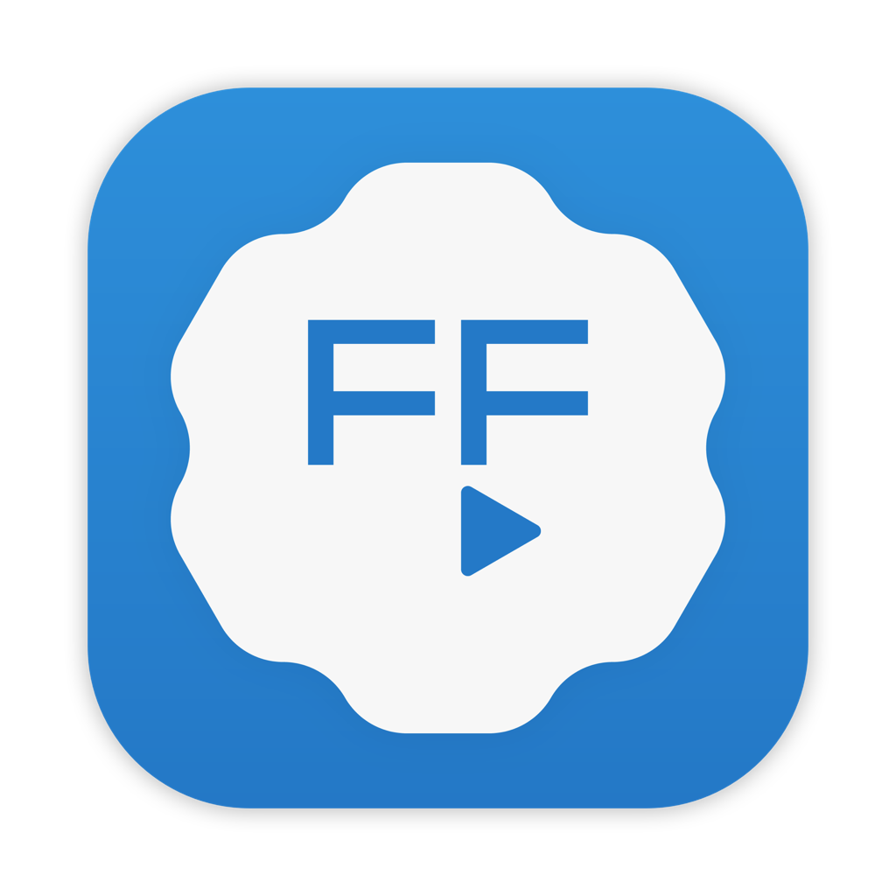

  

<h1 align="center">ffScope</h1>

  ffprobe / ffmpeg を使ったクロスプラットフォームのメディア解析 GUI 
  <em>A cross-platform media analysis GUI powered by ffprobe / ffmpeg</em>

  
  
  

---

メディアファイルをドラッグ&ドロップ（またはクリックで選択）すると、`ffprobe` を実行してフォーマット・ストリーム・メタデータを見やすく表示します。ビットレートグラフ、ラウドネス、HDR、画質比較（VMAF）、フレーム差分など、専門的な解析も 1 つのアプリで完結します。

- **動画・音声・画像に対応**: 静止画（PNG/JPG 等）はプレビュー付きの専用表示、アニメーション GIF/WebP は動画として解析
- **配布対象**: macOS（Apple Silicon）/ Windows（x64）
- **日英切替 (i18n)** ・ **ライト / ダークテーマ**

## モード

- **解析** — 1ファイルを詳細解析（タブ: 情報 / プレビュー / ビットレート / ラウドネス / 検査 / 納品仕様 / 総合チェック / 生JSON。静止画では対応する項目を表示）
- **比較** — 複数ファイルのメタデータ差分、画質比較(VMAF/PSNR/SSIM)、フレーム差分
- **バッチ** — 複数ファイルの主要スペックを一覧表に（動画・音声・画像の混在OK）
- **コマンド** — ffprobe 引数を自由に編集して実行（プリセット保存つき）
- **AI** — メディアの技術情報や選択した解析結果について質問（利用者のAPIキーが必要）

## 機能

### 情報 / メタデータ
- フォーマット / ストリーム / チャプター / メタデータの整形表示。取得した情報は生JSONでも確認可能。Unix時刻の日時変換に対応
- **警告検出**: VFR・映像/音声欠落・長さ不一致・アナモルフィック・非標準サンプルレート等
- **HDR / カラー情報**: primaries / transfer / space / bit depth を整形し HDR10・HLG を判定、MaxCLL / MaxFALL / Mastering Display の詳細取得
- **ファイルハッシュ**: MD5 / SHA-256（進捗バー）

### プレビュー
- **フレームピッカー**: シークバーでライブプレビュー、前後フレーム送り、任意フレームを JPG / PNG 保存
- **コンタクトシート**: ランダムな時刻から12枚のサムネイルを生成。拡大表示・再生成・JPG / PNG / TIFF保存に対応（進捗バー）
- **画像プレビュー**: 静止画は情報タブに原寸プレビューを表示（透過は市松模様で確認可）

### ビットレート
- **uPlot グラフ**: ホイールズーム / ドラッグパン、キーフレーム(GOP)重ね表示
- **統計**: 中央値 / p95 / p99 / ピーク平均比
- **GOP 構造**: 平均/最短/最長 GOP とヒストグラム
- **フレーム種別分布**: I/P/B 比率（**時間分割の並列解析＋進捗バー**）
- **タイムスタンプ不連続チェック**: DTSの巻き戻りと、表示順・パケットの継続時間を考慮した大きな空白を検出。BフレームによるPTSの前後や先頭の負のDTSは異常扱いしません

### ラウドネス（音声）
- **EBU R128 測定**: LUFS / True Peak / LRA と放送(-23)/配信(-14)基準との比較（進捗バー）
- **波形** ・ **スペクトログラム**

### 検査

- **視覚的な異常フレーム検出**: 前後の映像と比べて1〜3フレームだけ急変する候補を全フレーム走査（進捗バー・感度調整）。候補タイムライン、前/候補/次の画像確認、時刻・フレーム番号のJSON保存。低解像度での候補検出のため微細な乱れや長時間の異常は見逃す場合があり、フラッシュ等は目視確認が必要です。
- **整合性チェック**: 全体をデコードして破損・エラーを検出（進捗バー）
- **検出**: ブラックフレーム / 無音 / シーンチェンジ / クロップ（黒帯）

### 比較（2ファイル / 画像2枚もOK）
- メタデータ・各ストリームの差分ハイライト（**N ファイル**対応）
- **画質比較**: VMAF / PSNR / SSIM（進捗バー）
- **フレーム差分（差分合成）**: 一致部分は黒・差異は色（増幅 ×1〜32）、または**変化箇所だけオレンジ**表示（しきい値調整）
- **差分タイムライン**（動画のみ）: 全体をスキャンし**変化のある時間帯をオレンジ**で表示。感度スライダーで調整、クリックでその時刻へ

### 出力・その他

- **納品仕様**: 解像度・平均fps・映像/音声コーデック・サンプルレート・チャンネル数・統合LUFS・True Peakを編集可能な条件で判定。全ストリームを対象にし、ラウドネス未測定は未確認と表示します。初期値は設定例であり公式な納品規格ではありません。仕様の保存・判定結果のJSON出力に対応。
- **総合チェック**: 整合性・タイムスタンプ・ビットレート・フレーム種別・ラウドネス・黒フレーム/無音を順次実行。視覚的異常検出は追加選択できます。完了済み結果の再利用、工程ベースの進捗、残り工程の停止に対応し、別タブでも継続します。現在実行中の外部プロセスは途中終了せず、その工程の完了後に残りをスキップします。
- **レポート出力**: HTML / **PDF**（全フィールド込み）
- **コピー / エクスポート**: ffprobe コマンド・生 JSON のコピー / 保存
- **最近開いたファイル** ・ **完了トースト通知** ・ **ウィンドウ状態の記憶**
- **設定**: 言語 / テーマ / サムネイル位置 / ffprobe・ffmpeg パス上書き

## ダウンロードと起動

[GitHub Releases](https://github.com/CubeZeero/ffScope/releases/latest)から、お使いのOS向けのファイルをダウンロードしてください。

| 対象 | 形式 | 起動方法 |
| --- | --- | --- |
| macOS（Apple Silicon） | DMG | アプリをApplicationsへコピーして起動 |
| Windows（x64） | ポータブルZIP | フォルダごと展開し、`ffScope.exe`を起動 |
| Windows（x64） | セットアップexe | インストールして起動 |

配布版にはffmpeg / ffprobeを同梱しています。WindowsではWebView2ランタイムが必要です。
独自のffmpeg / ffprobeを使用する場合は、設定画面から実行ファイルを指定できます。
VMAFの測定にはlibvmaf対応のffmpegが必要です。

## AIアシスタント（任意）

1. 設定の「AI・APIキー」でOpenAIまたはClaude（Anthropic）を選びます。
2. 利用可能なモデルIDと、自分で発行したAPIキーを登録します。
3. AIタブで送信内容を確認し、外部送信・API料金に同意して質問します。

チャットサービスのサブスクリプションとは別に、各社のAPI利用料金がかかります。キーの保存操作では課金リクエストを行いません。

### 送信する情報とプライバシー

- APIキーはOSの資格情報ストアに保存します。
- 動画・音声・画像・ファイル名・パス・任意のメタデータタグ・解析の生ログは自動送信しません。
- 技術情報・警告・完了した解析結果の要約を、送信前に確認して選択できます。
- 質問本文と会話履歴は、選択したプロバイダーへ送信します。入力した情報はそのまま送信対象になるため、機密情報を含めないよう確認してください。
- 会話履歴はアプリのメモリ内で保持します。添付内容は会話開始時に固定され、新しい結果を使用する場合は会話をクリアします。
- 回答内のHTMLは実行せず、外部画像も自動読み込みしません。AIから返されたコマンドの自動実行は行いません。
- データの保持や取り扱い、料金は各プロバイダーの条件に従います。回答の正確性は利用者が確認してください。

## アプリの更新

「設定 → 更新 → 更新を確認」からGitHub Releasesの安定版を確認できます。
更新内容を確認してから、ダウンロード・インストールを実行してください。

macOS版とWindowsセットアップ版はアプリ内更新に対応します。初回は更新対応版を手動でインストールしてください。
Windowsポータブル版は、新しいZIPをダウンロードして更新します。

## ライセンス / 作者

- ffScope本体: **MIT**（[LICENSE](LICENSE)）
- 同梱FFmpeg: 本体とは別のライセンスが適用されます（[FFmpeg](https://ffmpeg.org/legal.html)）
- 開発者: **CubeZeero** — © 2026 CubeZeero
- リポジトリ: [CubeZeero/ffScope](https://github.com/CubeZeero/ffScope)
